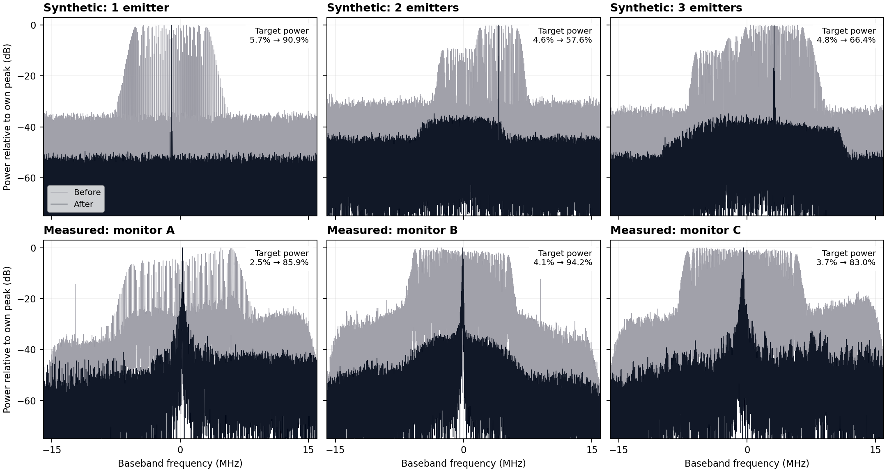
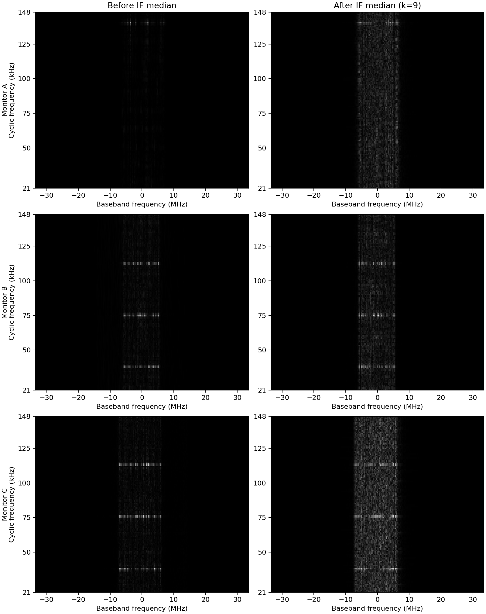

# SSC/TFM Estimation and Demodulation

Runnable examples for synthetic triangular-FM signals and anonymous measured
signals from **A, B and C**.

[Usage Guide](docs/usage.md) · [Validation](docs/validation.md)

The proposed method uses a median-preprocessed alpha–frequency image,
RT-DETR, local CZT and PSO. The baseline is IF-FFT-CZT-PSO. In mixtures,
the estimator targets the **dominant emitter**.



Gray: before demodulation; black: after. Each curve is normalized to its own
peak. Target power is the fraction within the final carrier ±250 kHz. For measured plots,
"before" means after the front-end filter and before demodulation.

## Contents

| Item | Location |
| --- | --- |
| Synthetic generator | `scripts/generate_synthetic.py` |
| Synthetic estimation and demodulation | `scripts/run_synthetic.py` |
| Measured estimation and demodulation | `scripts/run_measured.py` |
| Raw synthetic I/Q, one example each for 1, 2 and 3 emitters | `data/synthetic/emitter_1.npz` through `emitter_3.npz` |
| Raw measured I/Q, 50,000 complex samples each | `data/measured/monitor_A.npz` through `monitor_C.npz` |
| Inference checkpoint | `models/rtdetr_preprocessed.pt` |
| Anonymous expected outputs | `expected_results/` |

Only A/B/C identify measured signals. Hardware names, capture filenames,
original paths and experiment correspondence records are excluded.

## Install

Use Python **3.11**. On Linux:

```bash
python3.11 -m venv .venv
source .venv/bin/activate
python -m pip install --upgrade pip
python -m pip install torch==2.5.1 torchvision==0.20.1 --index-url https://download.pytorch.org/whl/cpu
python -m pip install -r requirements.txt
python scripts/verify_release.py
```

For CUDA or macOS, install matching wheels using the
[PyTorch installation commands](https://pytorch.org/get-started/previous-versions/)
before the remaining requirements. On Windows, activate with
`.venv\Scripts\activate`.

## Run and check

```bash
python scripts/run_synthetic.py --case all --device cpu
python scripts/run_measured.py --case all --device cpu
python scripts/check_results.py --synthetic outputs/synthetic --measured outputs/measured
```

The input files contain **raw I/Q before software filtering, phase
normalization, IF median filtering or demodulation**. Synthetic files contain
134,003 complex64 samples; each measured file contains exactly 50,000.
The sampling rate is 67,001,500 samples/s.

For measured input, the runner first applies its configured 30 MHz
raised-cosine frequency-domain filter. The proposed detector then uses
phase-only I/Q → IF → median filter → phase reconstruction → alpha–frequency
map. Demodulation operates on the band-filtered measured I/Q. Synthetic I/Q
does not use this front-end filter.

Cached PNGs are **derived detector inputs**, included alongside the raw I/Q
for fast tests. They are not the raw signals. All alpha–frequency PNGs show
**minimum cyclic frequency at the bottom and maximum at the top**. The runners
automatically convert that display orientation to the detector's input layout.
Logged detector-box coordinates use the layout recorded in
`coarse.box_coordinate_orientation`. To recalculate the images:

```bash
python scripts/run_measured.py --case A --recompute-image --device cpu --output outputs/full_processing
```

### Measured images before and after the IF median filter

For each of A/B/C, `data/measured/` contains:

| File | Meaning |
| --- | --- |
| `monitor_X_alpha_f_before_median.png` | Alpha–frequency map with the IF median filter skipped |
| `monitor_X_alpha_f_after_median.png` | Alpha–frequency map after IF median filtering, kernel 9; also the detector cache |

Both comparison branches start with the same 30 MHz front-end filter,
phase-only I/Q and IF trace, and reconstruct phase before making the map.
They use the same 49,999-sample length and map settings; only the IF median
filter differs. Each PNG independently min-max normalizes its map intensity,
so brightness is relative within that image. The NPZ still stores the
unchanged **50,000 raw complex samples**, before all these operations.



Regenerate the PNG pairs with:

```bash
python scripts/export_measured_median_images.py --case all --device cpu
```

The scripts resolve bundled paths relative to this folder and also work when
invoked by absolute script path from another working directory.

### Options

| Option | Values / purpose |
| --- | --- |
| `--case` | Synthetic: `all`, `1`, `2`, `3`; measured: `all`, `A`, `B`, `C` |
| `--method` | `proposed` (default), `baseline`, `both` |
| `--device` | `cpu` (default), or CUDA device such as `0` |
| `--input FILE.npz` | Evaluate a custom record instead of a bundled case |
| `--weights FILE.pt` | Use another compatible checkpoint |
| `--recompute-image` | Build the detector image from I/Q |
| `--output DIR` | Set output directory |
| `--threads N` | PyTorch CPU threads (default: 8) |
| `--no-plots` | Skip spectrum PNG/PDF export |

For example:

```bash
python scripts/run_measured.py --case B --method both --device cpu --output outputs/comparison
```

### Outputs and checks

Default output directories are `outputs/synthetic/` and `outputs/measured/`.
Each has `summary.csv` and case/method subdirectories with:

- `parameters.json`: estimates, processing settings and validation metrics
- `demodulated.npz`: demodulated complex I/Q
- `spectra.npz`: full linear spectra
- `spectra.csv`: compact spectra with preserved local peaks
- `spectrum.png`, `spectrum.pdf`: before/after comparison
- `alpha_f.png`: detector image displayed with cyclic frequency increasing upward

`success` means execution completed. Synthetic `joint_parameter_success`
requires center-frequency and bandwidth errors ≤500 kHz and modulation-rate
relative error ≤0.1%. Measured data has no parameter ground truth; validation
checks finite output, sample count and improved target concentration.
Measured target power uses the same carrier ±250 kHz interval before/after.
The bandwidth compression diagnostic is occupied bandwidth **before / after**;
its definition is recorded in `parameters.json`. PNR can be inflated by
filtered-out frequency bands and is not calibrated SNR.

To run both methods and check them:

```bash
python scripts/run_synthetic.py --case all --method both --device cpu --output outputs/check_synthetic
python scripts/run_measured.py --case all --method both --device cpu --output outputs/check_measured
python scripts/check_results.py --synthetic outputs/check_synthetic --measured outputs/check_measured
```

## Generate synthetic I/Q

Replay the three supplied examples:

```bash
python scripts/generate_synthetic.py --recipe bundled
```

Generate and evaluate a new three-emitter example:

```bash
python scripts/generate_synthetic.py --recipe new --emitters 3 --seed 1234 --gap-low-db 8 --gap-high-db 9 --output outputs/new_data
python scripts/run_synthetic.py --input outputs/new_data/emitter_3.npz --device cpu --output outputs/new_result
```

The gap bounds specify signal-to-disturbance ratio for one emitter and the
dominant-to-strongest-secondary amplitude gap for mixtures. Choose a fresh
output directory for generation. Arbitrary new records may fail the accuracy
checks; the bundled records are selected successful examples, not a benchmark.

## NPZ format

Input files contain `iq` (1D complex64), scalar `fs_hz`, and `metadata_json`
(a JSON string). Metadata is limited to anonymous labels, processing settings,
reproducibility parameters and synthetic ground truth where available.

```python
import json
import numpy as np

with np.load("data/measured/monitor_A.npz", allow_pickle=False) as record:
    raw_iq = record["iq"]
    fs_hz = float(record["fs_hz"])
    settings = json.loads(str(record["metadata_json"].item()))
```

Custom measured data can specify `front_end_filter` using the same schema
as the supplied records. If it is omitted, no front-end filter is applied.
`B_D` / `bandwidth_hz` means full peak-to-peak sweep bandwidth;
`f_range` is half that value. Carrier estimates are baseband offsets in Hz.

## Upload to GitHub

Place this folder's **contents** at the repository root, keeping `README.md`
at that level. The inference checkpoint is about 22 MB. To upload with Git:

```bash
git init
git add .
git commit -m "Add anonymous SSC/TFM examples"
git branch -M main
git remote add origin https://github.com/YOUR_ACCOUNT/YOUR_REPOSITORY.git
git push -u origin main
```

Replace the account/repository placeholders. `outputs/`, virtual environments
and Python caches are excluded by `.gitignore`. See
[GitHub upload instructions](https://docs.github.com/en/repositories/working-with-files/managing-files/adding-a-file-to-a-repository).

To upload later changes to an already configured repository, run these
commands from the release folder:

```bash
git add -A
git commit -m "Fix cyclic frequency axis orientation"
git push origin main
```
